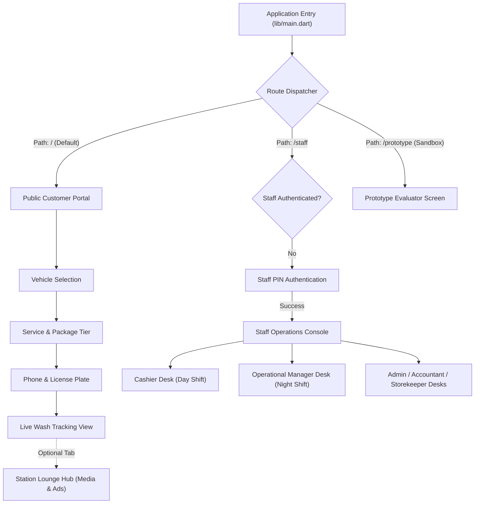

# Dual-Gateway Architecture & UI/UX Decluttering Design Document

*   **Author:** Tare
*   **Status:** Approved Draft (Reconciled with Multi-Lens Review)
*   **Date:** 2026-11-24

--------------------------------------------------------------------------------

## Overview

This document specifies the architectural redesign of the Bishe Car Wash frontend. The current single-page interface intermingles public customer booking with operational cashier and administrative workflows, leading to visual clutter, cognitive overload, and high drop-off. 

This design establishes a strict **Dual-Gateway Architecture**:
1. **Public Customer Portal (`/`)**: A minimal, conversion-focused consumer portal strictly dedicated to vehicle category selection, transparent package pricing, contact submission, and real-time wash progress tracking.
2. **Staff Operations Console (`/staff`)**: An authenticated operations terminal dedicated to Cashiers (Day Shift), Operational Managers (Night Shift), Storekeepers, Accountants, and Administrators, guarded by PIN security and auto-locking.

Promotional TikTok videos, marketing banners, and car-care reels are decoupled from the booking intake funnel and relocated into a dedicated **Station Lounge Hub**. Development begins with three isolated interactive prototype interaction models in a sandbox (`lib/features/prototypes/`) with zero modifications to production code until validation.

--------------------------------------------------------------------------------

## The Problem

1. **Audience Collision**: Walk-in customers, desk cashiers, night operational managers, storekeepers, and system administrators currently enter through a shared, cluttered interface. Customers are exposed to administrative role switchers, staff PIN dialogs, and internal terminology.
2. **Cognitive Overhead in Booking Funnel**: The entry screen forces customers through video carousels, Google Maps embeds, feedback triggers, and floating AI concierge sheets before they can select a wash package, creating friction and abandonment.
3. **Ergonomic Deficiency Under Sunlight**: Dense multi-column layouts and undersized buttons are difficult to operate on mobile phones outdoors under bright Bishoftu sunlight.
4. **Ad Scalability Bottleneck**: Video marketing assets are mixed directly into operational screens, preventing the station from scaling its future video advertising and commercial promotion pipeline cleanly.

--------------------------------------------------------------------------------

## Goals

*   **Decoupled Dual-Gateway Routing**: Establish distinct, independent entry routes for the Public Customer Portal (`/`) and the Staff Operations Console (`/staff`).
*   **Sub-30-Second Booking Intake**: Reduce the primary consumer booking path to a focused, linear flow requiring under 30 seconds to complete.
*   **Dedicated Station Lounge & Ad Hub**: Isolate marketing media and future promotional video ads into a dedicated destination accessible during and after service.
*   **Three Isolated Interactive Prototypes**: Implement three distinct interaction models (Linear Stepper, Modern Web Portal, Express Kiosk) in an isolated sandbox (`lib/features/prototypes/`) using in-memory mock repositories before modifying production code.
*   **Strict Operational Symmetry & Zero Data Mutation**: Guarantee 100% operational symmetry between Day (Cashier) and Night (Operational Manager) shift desks, zero test data insertion into live Supabase tables (Workspace Rule 10), and complete trilingual coverage (EN, OM, AM).

--------------------------------------------------------------------------------

## Non-Goals

*   **Direct Production Code Modification During Prototyping**: No existing production screens (`lib/features/customer/`, `lib/features/cashier/`, `lib/features/admin/`, `lib/features/manager/`) will be altered during the prototype sandbox phase.
*   **Database Schema & Contract Alterations**: No changes to existing Supabase tables (`wash_bookings`, `daily_closings`, `commission_logs`, `bank_incoming_transactions`), RPCs, or serialization schemas.
*   **Backend State Management Replacement**: No replacement of the existing reactive state architecture (`AppStateNotifier` / `InheritedNotifier`).

--------------------------------------------------------------------------------

## Open Questions

*   **Question 1**: What is the preferred physical handoff gesture on shared station reception tablets to allow attendants to enter `/staff` without manually typing browser URLs? (Resolved: discrete 1.5s long-press on the station crest `AutoCareAssets.logo` in `AppRoleHeader` + 4-digit PIN challenge).
*   **Question 2**: Which of the three prototype interaction models (Linear Funnel, Modern SaaS Portal, Express Kiosk) provides the highest completion velocity across Bishoftu driver demographics? (To be evaluated via Phase 1 Sandbox).

--------------------------------------------------------------------------------

## Critical User Journeys (CUJs)

### CUJ 1: First-Time Customer Express Booking
*   **Given**: A driver arrives at the Bishoftu station or opens the web app on mobile.
*   **When**: The user loads the public URL (`/`), selects their vehicle category (e.g. Minibus), picks a package tier (e.g. Standard Clean), enters their license plate and phone number, and taps "Confirm & Drive In".
*   **Then**: The booking is recorded in under 30 seconds, an ephemeral tracking token is stored locally, and the screen transitions immediately to the Live Wash Tracking view with the assigned bay number (e.g. Bay 1) or active queue ticket position (e.g. Queue #3, estimated wait ~12 mins).

### CUJ 2: Vehicle In-Bay Progress & Station Lounge Exploration
*   **Given**: The customer's vehicle is actively being washed in Bay 1.
*   **When**: The customer opens their Live Wash Tracking screen, checks progress through the 6-stage visual progress indicator (`pending` -> `assignedToBay` -> `washing` -> `drying` -> `readyForPickup` -> `completed`), and optionally taps "Explore Station Lounge".
*   **Then**: The customer watches car care media and promotional video reels without obscuring or interrupting their active wash status updates.

### CUJ 3: Station Staff Operations & Night Shift Custody
*   **Given**: A Cashier (Day) or Operational Manager (Night) opens the station device terminal.
*   **When**: The staff member accesses `/staff` (or long-presses `AutoCareAssets.logo` in `AppRoleHeader`) and inputs their 4-digit staff PIN into `RoleAuthDialog`.
*   **Then**: The authenticated Staff Operations Console opens with full queue management, live bay status dispatching, incoming Telebirr/CBE bank SMS matching, and daily shift closing reports, locked to unauthorized public users.

--------------------------------------------------------------------------------

## Technical Plan (Architecture)

### 1. High-Level Gateway Architecture & Routing Seam

The application entrypoint (`lib/main.dart` and `RoleShellScreen`) will be restructured into a clean two-gateway router:
*   **Public Gateway (`/`)**: Routes by default to the focused Public Customer Portal. It mounts only lightweight, customer-centric state models and assets.
*   **Staff Gateway (`/staff`)**: Routes to the authenticated Staff Operations Console. Access is protected by `StaffAuthenticator` (`lib/features/auth_roles/domain/models/staff_authenticator.dart`) PIN challenge. If unauthenticated, it renders a minimal login screen; upon PIN verification, it renders the station operational desk based on staff role.
*   **Discrete Handoff Mechanism**: On shared station reception devices running in customer mode, attendants trigger the login challenge by long-pressing the header station crest (`AutoCareAssets.logo` inside `AppRoleHeader` at `lib/core/widgets/app_role_header.dart`) for 1.5 seconds or pressing `Ctrl + Shift + S`, opening `RoleAuthDialog` (`lib/features/auth_roles/presentation/widgets/role_auth_dialog.dart`) without exposing visible staff buttons to consumers.
*   **Sandbox Evaluation Seam**: During Phase 1 evaluation, the prototype evaluator harness is accessible via an isolated route `/#/prototype` (or a conditional floating debug trigger active when `kDebugMode` is true), ensuring zero mutation of production screens.



### 2. Isolated Prototype Sandbox Architecture (`lib/features/prototypes/`)

To guarantee zero regression and zero production code mutation during the evaluation phase, three independent interaction models are built in an isolated feature sandbox:

```
lib/features/prototypes/
├── domain/
│   └── models/prototype_model_type.dart           # Enum: stepper, saasPortal, expressKiosk
├── data/
│   └── mock_prototype_wash_repository.dart        # In-memory mock extending WashRepositoryImpl
└── presentation/
    ├── screens/
    │   ├── prototype_evaluator_screen.dart        # Switcher harness to compare models side-by-side
    │   └── prototype_station_lounge_screen.dart   # Sandbox preview of Station Lounge & Ad Hub
    └── widgets/
        ├── prototype_1_stepper_view.dart          # Model 1: Linear 3-step consumer wizard
        ├── prototype_2_saas_portal_view.dart      # Model 2: Responsive dual-card live capacity portal
        ├── prototype_3_express_kiosk_view.dart    # Model 3: Ultra-compact sub-15s single-screen form
        └── prototype_live_ticket_view.dart        # Shared digital ticket & wash progress component
```

#### Prototype Interaction Model Specifications:

1.  **Prototype 1: Linear Consumer Funnel (App-Style Stepper)**
    *   *Interaction:* Sequential, single-column vertical stepper with prominent back/next buttons.
    *   *Step 1:* Vehicle Category cards (Sedan, SUV/4WD, Minibus, Truck, Carpet) with tactile feedback.
    *   *Step 2:* Fixed price tiers (Standard Clean, Executive Detailing, Underbody Wash).
    *   *Step 3:* License plate and phone input with auto-formatting and confirmation trigger.
    *   *Target Completion Time:* 25–35 seconds. Ideal for first-time private car owners.

2.  **Prototype 2: Modern Web Portal (SaaS-Style Dual Card)**
    *   *Interaction:* Responsive card layout. On desktop/tablet (>600px), renders a dual-card view. On mobile (<600px), layout stacks vertically with the **Express Booking Form prioritized above the fold** and station telemetry condensed into a compact top status badge.
    *   *Telemetry Card:* Live Station Telemetry showing Bay 1 and Bay 2 availability, queue wait time estimate, and active attendant count.
    *   *Booking Card:* Interactive express booking card with segmented vehicle chips, package dropdown, instant dynamic price computation, and submit button.
    *   *Target Completion Time:* 20–30 seconds. Ideal for web booking and reception tablets.

3.  **Prototype 3: Express Kiosk / Speed Intake (Single-Screen Form)**
    *   *Interaction:* A single, ultra-dense card with zero page transitions.
    *   *Top:* 2x2 responsive grid (or horizontally scrolling chip row on narrow viewports) with flexible label wrapping for Afaan Oromoo and Amharic strings to prevent text clipping.
    *   *Middle:* Chunky selectable package cards or tactile pills with minimum 48x48dp hit targets and prominent ETB price tags (replacing error-prone standard radio buttons).
    *   *Bottom:* Dual input fields (Plate Number, Phone Number) and full-width 56dp "Instant Book" CTA.
    *   *Target Completion Time:* <15 seconds. Optimized for repeat taxi, ride-hail, and commercial drivers.

### 3. Station Lounge Hub Architecture

*   **Location:** `lib/features/prototypes/presentation/screens/prototype_station_lounge_screen.dart` (Phase 1 Sandbox) -> `lib/features/welcome/presentation/screens/station_lounge_screen.dart` (Phase 2 Cutover).
*   **Access:** Accessible via a non-intrusive navigation tab or as an optional "Waiting for your wash? Explore Station Lounge" link within the Live Tracking screen.
*   **Capabilities:**
    *   TikTok car-care reels and detailing video player (`AdVideoShowcaseCard` at `lib/features/welcome/presentation/widgets/ad_video_showcase_card.dart`).
    *   Station amenity showcases (VIP lounge, cafe, pressure wash equipment).
    *   Future commercial advertisement banner slots and partner promotions.
    *   Customer feedback and review submission sheet.

### 4. Hermetic Data Access & Egress Economics

*   **Zero Live Supabase Pollution:** `MockPrototypeWashRepository` extends `WashRepositoryImpl` (`lib/features/booking_service/data/repositories/wash_repository_impl.dart`), inheriting composite domain methods and overriding only prototype booking and status methods in-memory. Zero synthetic records are inserted into live Supabase tables, upholding Workspace Rule 10.
*   **Bounded Telemetry Polling Lifecycle:** When live tracking is active, the client polls single-record status endpoints (`/rest/v1/wash_bookings?id=eq.<id>&select=id,status,bay_number,updated_at`) with a 10-second polling interval (<100 bytes per poll). Polling timers are immediately canceled when the wash status reaches `completed` or `picked_up`, or when the application enters `AppLifecycleState.paused`.
*   **Day/Night Operational Symmetry:** Both Cashier (Day) and Operational Manager (Night) views use identical state transition dispatches (`startWashing`, `moveToDetailing`, `readyForPickup`, `completeWashAndFreeBay`), preserving 100% operational parity (Workspace Rule 11).

--------------------------------------------------------------------------------

## Alternatives Considered

### Alternative A: Retain Monolithic Screen with Role Navigation Tabs

*   **Pros**: Requires no routing restructure; all views remain in existing `RoleShellScreen`.
*   **Cons**: Preserves the core audience collision; exposes walk-in customers to staff terminology and role authentication challenges; does not decompress mobile screen density.
*   **Reason for Rejection**: *Rejected by author: Fails to solve the primary cognitive overload. End customers must not be exposed to operational staff controls, drawer switchers, or cashier queue tooling.*

### Alternative B: Two Separate Repositories / Dedicated Applications (Customer Web vs Staff APK)

*   **Pros**: Physical isolation of codebases; customer web bundle contains zero staff widgets.
*   **Cons**: Doubles repository management overhead, duplicates shared domain entities (`WashBooking`, `CarType`, `WashPackage`), requires two separate CI/CD pipelines, and slows feature iteration.
*   **Reason for Rejection**: *Rejected by author: Introduces unnecessary maintenance bloat (violates YAGNI). A unified Flutter codebase utilizing route-level gateway decoupling (`/` vs `/staff`) achieves identical UX and security isolation with zero codebase fragmentation.*

### Alternative C: Mandatory User Account Creation (Email/Password or OTP) Before Booking

*   **Pros**: Enables long-term customer accounts, stored payment methods, and automated loyalty tracking.
*   **Cons**: Creates severe intake friction for walk-in drivers and commercial taxi operators; high drop-off rate on slow 3G mobile connections.
*   **Reason for Rejection**: *Rejected by author: Results in severe booking funnel abandonment. Ephemeral identification using License Plate and Phone Number provides instant sub-30-second intake while preserving transaction matching in Supabase.*

### Alternative D: Complete Deletion of Video Marketing Reels & Promotional Showcases

*   **Pros**: Reduces bundle size and removes video player controller complexity entirely.
*   **Cons**: Discards existing station branding assets and eliminates the future commercial advertising pipeline for company videos and partner car-care products.
*   **Reason for Rejection**: *Rejected by author: Destroys marketing value and advertising scalability. Relocating promotional media into a dedicated "Station Lounge Hub" decouples it from the intake bottleneck while preserving brand storytelling and future ad revenue.*

--------------------------------------------------------------------------------

## Non-Functional Requirements

### Security & Privacy
*   **Role Isolation**: Public gateway (`/`) contains zero references or UI widgets that expose staff credentials, cashier balances, washer salaries, or daily financial closings.
*   **Authentication & Auto-Lock**: The Staff Console (`/staff`) strictly enforces 4-digit PIN verification via `StaffAuthenticator` (`lib/features/auth_roles/domain/models/staff_authenticator.dart`). Session state auto-locks after 60 seconds of inactivity on station tablets.
*   **Ephemeral Data Storage**: Customer phone numbers and license plates stored in local storage are used exclusively for active wash progress restoration and expire after 12 hours (validated via timestamp check against `DateTime.now()` on fetch).

### Performance & Latency
*   **Intake Velocity**: Maximum time-to-book under 30 seconds for first-time users (Prototype 1 & 2) and under 15 seconds for repeat users (Prototype 3).
*   **Network & Telemetry Economy**: All live status polling enforces single-record limits (`limit=1`) with a 10-second interval, transferring <100 bytes per cycle.
*   **Hermetic Prototyping**: The prototype sandbox operates 100% in-memory with zero network latency and zero database egress.

### Rollout, Rollback & Compatibility
*   **Isolated Sandbox Safety**: All prototype code lives exclusively in `lib/features/prototypes/`. Production files remain 100% untouched until explicit user sign-off (Workspace Rule 2).
*   **Trilingual Parity**: 100% of text elements across all three prototypes are localized in English, Afaan Oromoo, and Amharic via `AppStrings` (`lib/core/localization/app_strings.dart`) using non-breaking additive keys.

--------------------------------------------------------------------------------

## Detailed Implementation Plan

### Phase 1: Prototype Sandbox Construction (Current Scope)

All work in this phase is restricted to an isolated sandbox to ensure zero production regression and zero mutation of live station operations.

#### Target Files to Create / Modify:

1.  `lib/features/prototypes/domain/models/prototype_model_type.dart` (Create)
    *   *Type / Scope*: Domain Value Object / Enum.
    *   *Rationale*: Defines the `PrototypeModelType` enum (`stepper`, `saasPortal`, `expressKiosk`) and associated metadata to configure the evaluation harness.

2.  `lib/features/prototypes/data/mock_prototype_wash_repository.dart` (Create)
    *   *Type / Scope*: In-Memory Repository Implementation.
    *   *Rationale*: Extends `WashRepositoryImpl` (`lib/features/booking_service/data/repositories/wash_repository_impl.dart`), inheriting all composite methods of `IWashRepository` (`lib/features/booking_service/domain/repositories/i_wash_repository.dart`) and overriding only prototype booking submissions and live telemetry snapshots in-memory, guaranteeing strict adherence to Workspace Rule 10.

3.  `lib/features/prototypes/presentation/screens/prototype_evaluator_screen.dart` (Create)
    *   *Type / Scope*: UI Evaluator Screen & Harness.
    *   *Rationale*: Provides an interactive comparison workbench featuring a top control bar (switch between Model 1, Model 2, and Model 3; toggle Mobile 390px vs Tablet 850px preview frames; toggle language EN/OM/AM) allowing real-time side-by-side evaluation without touching production routes.

4.  `lib/features/prototypes/presentation/widgets/prototype_1_stepper_view.dart` (Create)
    *   *Type / Scope*: UI Presentation Component (Model 1).
    *   *Rationale*: Implements the Linear Consumer Funnel: a 3-step progressive stepper with tactile vehicle cards, package pricing tiers, and contact inputs.

5.  `lib/features/prototypes/presentation/widgets/prototype_2_saas_portal_view.dart` (Create)
    *   *Type / Scope*: UI Presentation Component (Model 2).
    *   *Rationale*: Implements the Modern Web Portal: a dual-card layout displaying real-time station bay capacity alongside an express dynamic pricing calculator (with mobile-first vertical card ordering).

6.  `lib/features/prototypes/presentation/widgets/prototype_3_express_kiosk_view.dart` (Create)
    *   *Type / Scope*: UI Presentation Component (Model 3).
    *   *Rationale*: Implements the Express Kiosk: a high-density, single-screen form featuring a 2x2 responsive grid for vehicle selection and 48x48dp tactile cards for package tiers, optimized for sub-15-second intake by commercial and fleet drivers.

7.  `lib/features/prototypes/presentation/widgets/prototype_live_ticket_view.dart` (Create)
    *   *Type / Scope*: UI Presentation Component (Common).
    *   *Rationale*: Shared post-booking view rendering an instant digital wash ticket, assigned bay or queue position indicator, 6-stage visual progress stepper (`pending` -> `assignedToBay` -> `washing` -> `drying` -> `readyForPickup` -> `completed`), and a discrete button to explore the Station Lounge.

8.  `lib/features/prototypes/presentation/screens/prototype_station_lounge_screen.dart` (Create)
    *   *Type / Scope*: UI Feature Screen (Sandbox Preview).
    *   *Rationale*: Dedicated Station Lounge & Ad Hub preview hosting TikTok promotional reels (`AdVideoShowcaseCard`), station amenity galleries, car-care tips, and customer feedback forms, fully decoupled from the vehicle intake funnel.

9.  `lib/core/localization/app_strings.dart` (Modify)
    *   *Type / Scope*: Core Localization Dictionary.
    *   *Rationale*: Adds additive non-breaking trilingual keys (EN, OM, AM) for prototype model titles, step indicators, express buttons, and lounge captions.

10. `test/prototypes/prototype_models_test.dart` (Create)
    *   *Type / Scope*: Unit & Widget Test Suite.
    *   *Rationale*: Hermetic test suite validating that all three prototype interaction models complete bookings cleanly in memory, validate inputs, format currency properly, and handle trilingual text expansion without layout overflows or network hits.

--------------------------------------------------------------------------------

### Phase 2: Production Gateway Integration (Subsequent Phase After Prototype Selection)

Once the user evaluates the sandbox and selects the winning interaction model, the production integration will be executed:

11. `lib/features/welcome/presentation/screens/station_lounge_screen.dart` (Create)
    *   *Type / Scope*: Production Feature Screen.
    *   *Rationale*: Promotes the sandbox Station Lounge screen into production feature hierarchy.

12. `lib/features/auth_roles/presentation/screens/role_shell_screen.dart` (Modify)
    *   *Type / Scope*: Presentation Routing Shell.
    *   *Rationale*: Removes internal staff role selectors from public customer viewports and sets up gateway separation.

13. `lib/main.dart` (Modify)
    *   *Type / Scope*: Application Entrypoint.
    *   *Rationale*: Binds `/` to the approved customer interface and `/staff` to the authenticated staff console.

--------------------------------------------------------------------------------

## Verification Plan

### Automated Testing
*   **Hermetic Unit & Widget Tests**:
    ```bash
    flutter test test/prototypes/prototype_models_test.dart
    ```
    *Assertions*:
    - All three prototype views mount without layout overflows across mobile (360px-420px) and tablet (768px-1024px) widths.
    - Booking submissions update the in-memory repository and transition to the Live Ticket view.
    - Trilingual strings resolve without raw English fallbacks or missing keys.

### Static Analysis
*   **Dart Analyzer**:
    ```bash
    dart analyze lib/features/prototypes/
    ```
    *Requirement*: Zero errors, zero warnings.

### Production Bundle Build Verification
*   **Web Release Build**:
    ```bash
    flutter build web --release
    ```
    *Requirement*: Compilation succeeds with zero breaking changes to existing production bundles.

--------------------------------------------------------------------------------

*Drafted with EGM*
